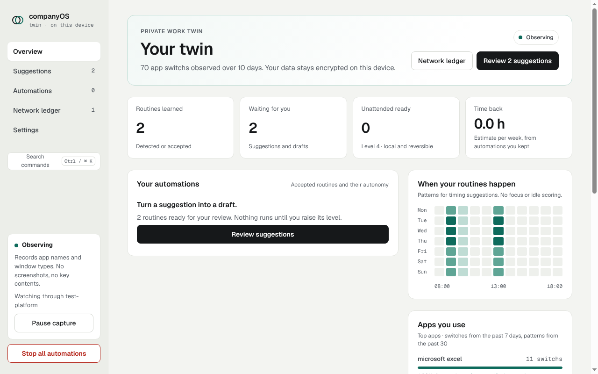
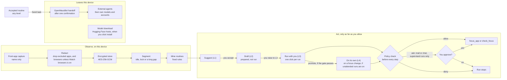
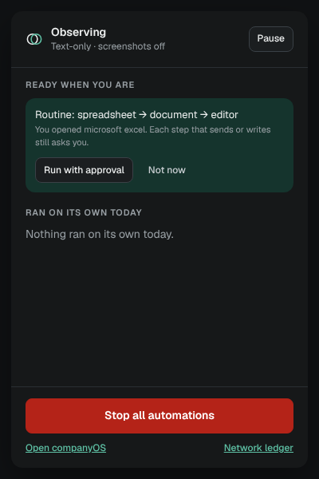
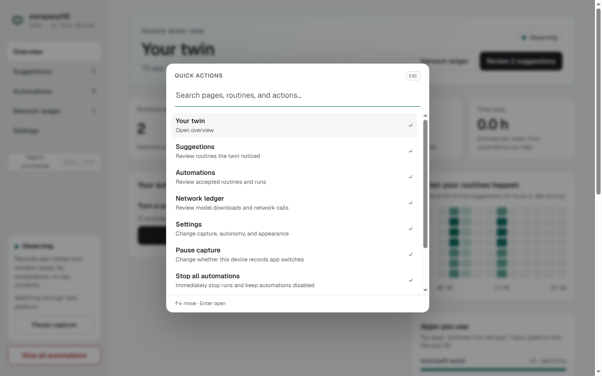
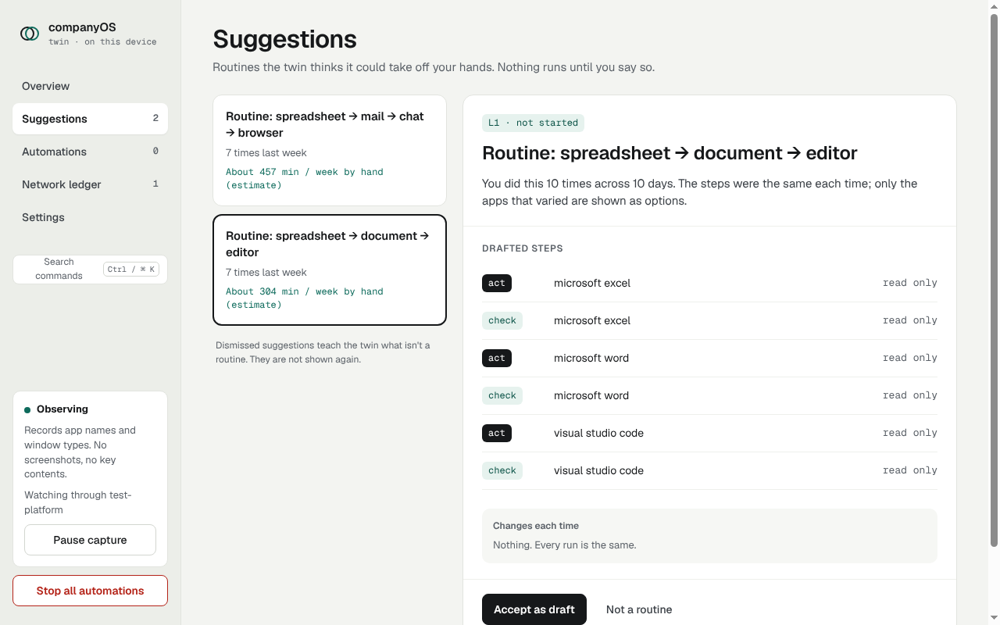
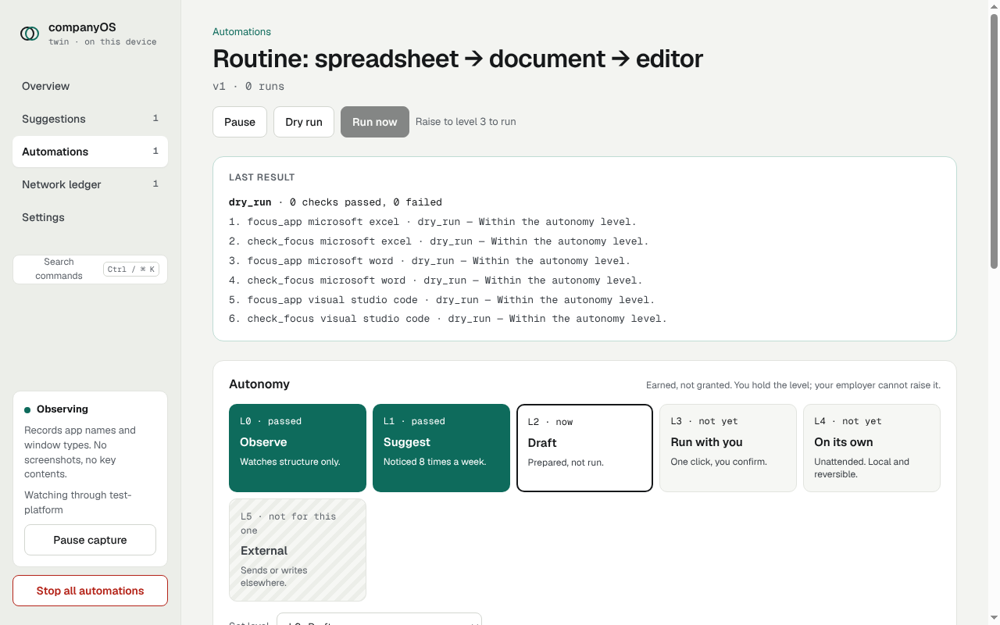
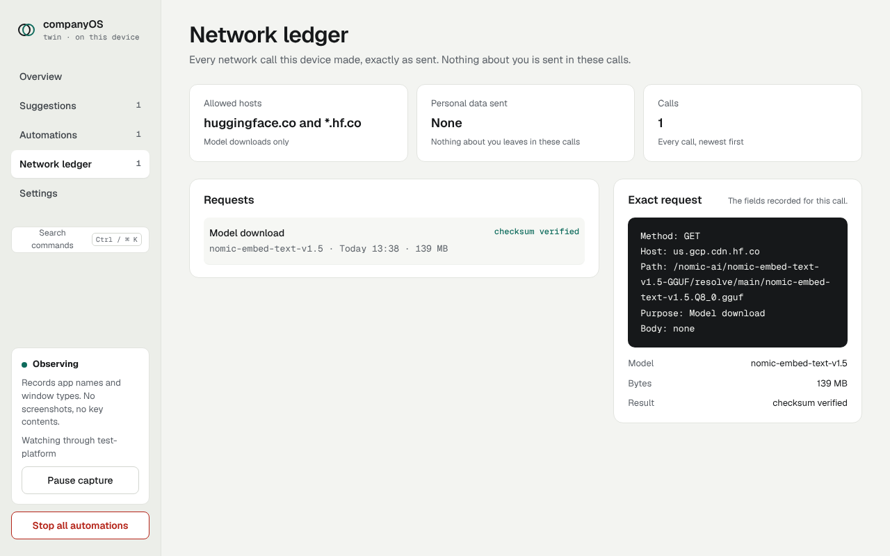

# companyOS Twin

A private work twin for your desktop. It learns the routines you repeat across apps, offers them as automations, and runs them on its own only when you have earned that.


<picture>
  <source media="(prefers-color-scheme: dark)" srcset="docs/screenshots/overview-dark.png">
  
</picture>

## What it is

companyOS Twin is an Electron desktop app with a TypeScript engine. It watches which app is in front, by name only, and finds sequences of apps that you repeat, such as a spreadsheet, then a document, then an editor. It offers each sequence as a suggestion. Accepting one creates an automation, which starts as a draft.

A draft runs nothing. At level 3 you start each run with one click, and mail and chat steps ask again. A routine runs on its own only at level 4, only when the maximum level is 4 and you enable unattended runs, and only after it has passed the promotion gate. Recorded data is stored encrypted on this device.

### Highlights

- **App names, not content.** The twin records which app is in front and when. It has no keyboard hook, and its capture adapters return app names only. It never reads window titles or page contents.
- **Encrypted records.** Each record is sealed with AES-256-GCM. The data key is sealed by the OS secure store, and the app does not start without one. Exports and downloaded model files are plain files.
- **Fixed rules.** Routines are found and named by deterministic rules. No model is involved yet.
- **Earned autonomy.** Six levels (L0 to L5), a deterministic policy check before every step, and a promotion gate. A failed or undone run demotes the routine.
- **It offers, you decide.** At level 3 or above, the tray offers a routine when its first app opens. Each offer runs only after you approve it. The one exception is a level 4 routine with unattended runs allowed, described under [Autonomy is earned](#autonomy-is-earned).
- **Open models, downloaded and verified.** Six Apache-2.0 models from a fixed catalogue, sized to the device. Setup downloads them from Hugging Face hosts and checks pinned SHA-256 digests. Nothing loads them yet.
- **Optional OpenMausBot handoff.** From an accepted routine, send a task brief to an external agent CLI after one confirmation. See [OpenMausBot handoff](#openmausbot-handoff).

> [!NOTE]
> This is an early preview. Installed models are not loaded yet, and some paths are not covered by tests. Read [Status](#status) before you rely on it.

## How it works



An **app category** (the code calls it a window class) groups apps such as `spreadsheet` or `mail`. Routines are keyed by app category, not by app name. A **segment** is a run of focus events between boundaries. Level 4 is the only path that can start a run without you. An OpenMausBot handoff also acts after one confirmation, under OpenMausBot's own rules.

| Stage | Rule | Value |
| --- | --- | --- |
| Poll | Read the front app on a timer. Store an event only when the app changes. | Every 3 s on macOS and Linux X11, every 5 s on Windows |
| Redact | Lower-case the name, drop `.app` or `.exe`, drop excluded apps, and drop browsers unless **Watch browsers** is on. | 10 default exclusions |
| Classify | Map the name to an app category through a fixed list. | 8 classes, 57 names. Anything else is `other`. |
| Idle | Record idle start and end from OS idle time. | Idle after 5 min without input |
| Segment | Close the segment on idle, on lock, or when the gap between focus events is longer than `idleGapMs`. | Default 60 min, allowed 1 to 60 min |
| Mine | Over the last 30 days, skip `other`, merge neighbouring apps of one class, and keep class sequences of 3 to 6 steps. | Seen in at least 3 segments on at least 3 local days |
| Score | Rank routines for display. The score is never a threshold. | `min(1, segments/10) × min(1, days/7)` |
| Compile | Each position becomes `focus_app`, then `check_focus`. A position with several apps becomes a choice. The default name is `Routine:` plus the app categories. | At most 12 steps, 2 to 5 options per choice, names up to 80 characters (see [Known issues](#known-issues)) |
| Prune | Delete raw events older than the retention window. | 90 days, at start-up and every 24 h |

The mining thresholds, the 30-day window and the retention period are fixed in code. The idle gap is the only segmentation setting.

The overview's **Apps you use** panel shows a learning score for each app. It is the highest score among the mined routines that include the app, shown as a percentage. It measures repetition only. It is not model confidence or a success rate. From 80% the label reads "Strong", the bar fill changes to the accent colour, and the status text turns teal. This changes how the score looks, not what the twin does. Focus changes the twin makes during its own runs are recorded like any other, so runs can add to a routine's repetition count and score.

## What it sees, and what it never sees

| Recorded | Never recorded |
| --- | --- |
| The name of the app in front: the process name on macOS and Windows, the window class on Linux X11 | Window titles. The adapters return names only, and the signal schema is strict. |
| Each change of front app, with its time | Keystrokes or typed text. There is no keyboard hook. |
| Idle start and end, once OS idle time reaches 5 minutes | Screenshots. No screen-capture API is used. |
| Screen lock and unlock, on macOS and Windows | Document, page, message or file contents |
| Browser app names, only with **Watch browsers** on | URLs. No platform adapter sends one, so none are recorded today. |
| | Apps on the exclusion list, and the twin's own app |

If a URL were ever supplied with **Watch browsers** on, the engine would keep only the host and the first path segment. That segment is kept only if it is a short lowercase word, and otherwise becomes `:id`. Query strings and fragments are dropped.

The default exclusions are `1password`, `bitwarden`, `keepass`, `keepassxc`, `dashlane`, `lastpass`, `enpass`, `keychain access`, `seahorse` and `kwalletmanager`. They cover password managers and keyring apps only. Banking, health, HR and messaging apps are not excluded.

> [!WARNING]
> Private and incognito windows are not detected, and secure-input fields are not detected. With **Watch browsers** on, a private window is recorded under its browser's name. Only app names are read, so page contents are never stored, but private windows are not excluded. The setup screen lists private windows under "Never recorded". That is not enforced.

### Data controls

- **Pause capture.** Available from the sidebar, the tray popover, the tray menu and the command palette. Capture stops reading the front app until you resume it or the app restarts. Lock and unlock markers are still stored while paused. Pause does not stop a run in progress. Use **Stop all automations** for that.
- **Exclude an app.** Adding an app deletes its stored events, and its focus is not recorded again. Automations that already use the app keep its name, and a step that uses it is denied when it runs. An OpenMausBot handoff does not check this list, so its prompt can still name the app.
- **Retention.** Raw events older than 90 days are deleted at start-up, then every 24 hours. The period is fixed. The ledger, automations, autonomy state and settings are not pruned.
- **Export my data.** In **Settings → Data**, after a warning that the file is not encrypted. The file, `companyos-twin-export.json`, holds recorded events, automations, autonomy state and run history, the network ledger, and your settings, including the OpenMausBot executable and target. A new file has mode `0600`. Saving over an existing file keeps that file's permissions.
- **Delete everything.** In **Settings → Data**. Asks twice, then stops capture, deletes the five data files and the sealed data key, and relaunches. Settings are deleted too, so setup runs again. Files are deleted, not overwritten, so their contents may be recoverable from disk. Model files in `models/`, any export you saved, the OS-side secret that unwraps the key, and any OpenMausBot job or task tree are not removed.
- **Close is not quit.** Closing the main window hides it, and capture keeps running. Use **Quit** in the tray menu to quit.

## Autonomy is earned

| Level | Name | What it allows | How it is reached |
| --- | --- | --- | --- |
| L0 | Observe | Watches structure only. No automation step runs. | Set on the automation page |
| L1 | Suggest | Shown in Suggestions. No step runs. | Found by mining |
| L2 | Draft | Prepared, not run. A dry run previews each step. | New automations start here |
| L3 | Run with you | One-click supervised runs. Mail and chat steps ask first. | Set on the automation page |
| L4 | On its own | Unattended runs of local steps only, when enabled. | Promotion only |
| L5 | External | Sends or writes elsewhere. Not built. Always denied. | Not in this version |

An OpenMausBot handoff can be sent from an accepted routine at any level, so the levels do not govern handoffs.

Each step's **effect** is derived from its operation and app: `read_only` (no change), `local_reversible` (a change on this device that the rules treat as reversible, never produced today), or `external_effect` (a change outside the device; today, bringing a mail or chat app to the front). `money`, `deletion`, `permission` and `install` are also effects.

**Policy check.** Ordinary code, not a model, runs before every step. The first matching row decides.

| # | Condition | Result |
| --- | --- | --- |
| 1 | The step's app is on the exclusion list | Deny |
| 2 | The level is above `maxAutonomyLevel` | Deny |
| 3 | The level is 5 | Deny |
| 4 | The level is 2 or lower | Deny: "Draft level: shown for review, not executed." |
| 5 | The effect always needs a person (below) | Ask in a supervised run. Deny when unattended. |
| 6 | Unattended, and the level is below 4 | Deny |
| 7 | Anything else | Allow |

Dry runs evaluate each step as if the automation were at level 3, so the preview shows every approval a supervised run would need.

**Always asks.** Five effect classes always need a person: `external_effect`, `money`, `deletion`, `permission` and `install`. Of these, only `external_effect` can occur today. It applies to bringing a mail or chat app to the front, such as Outlook, Thunderbird, Slack, Teams, Discord, Zoom, Telegram, WhatsApp or Messages. The dialog reads `Bring "<app>" to the front?` with **Allow this step** and **Stop the run**. **Stop the run** is the default, and Escape also stops. An automation that touches a mail or chat app can never reach L4.

**The promotion gate to L4.** The gate is checked once, when you select **Let it run on its own**. All of these must hold:

- The automation is at L3, `maxAutonomyLevel` is 4, and **Allow unattended runs at level 4** is on. The maximum defaults to 3, and unattended runs default to off, so level 4 is not allowed by default.
- Every effect is `read_only` or `local_reversible`. Only `read_only` is produced today, so no mail or chat step qualifies.
- At least 10 supervised runs at L3, counted over the last 500 runs kept.
- At least 25 runs in the last 14 days, with a postcondition pass rate of at least 99%. A postcondition is a `check_focus` step that finds the expected app in front.
- No failed run and no reverted run in those 14 days.

The Automations page lists each check with its reason. The thresholds are design values, not sourced standards.

**Demotion.** A failed run, or **Undo**, sets the automation to L3 or lower at once. The 14-day window must then be clean again before promotion. **Undo** marks the newest run as reverted and rolls nothing back. The gate is not checked again after promotion. A level 4 routine keeps running unattended until a failed or undone run drops it to L3, even if its run count or pass rate later falls below the thresholds. Turning off **Allow unattended runs at level 4**, or lowering the maximum below 4, does not change a routine's level. The routine stays at level 4 and resumes unattended runs when the setting is turned back on, without a new check. To stop that, use **Pause** on the automation page, which drops the routine to level 2.

**Level 4 path.** A focus change to an app that opens a level 4 routine starts that routine at once, with no offer. This needs all of these: capture running, no run or offer active, automations on, the routine at level 4 with the maximum at 4, **Allow unattended runs at level 4** on, and every effect `read_only` or `local_reversible`. It also obeys the offer limits: the routine was not offered or started in the last hour, was not declined in the last 4 hours, has started fewer than six times today, and no run ended in the last two minutes. If the first step has several observed apps, the run uses the one seen most often there, which may not be the app you opened. The run then brings apps to the front in turn, with no prompt, while you may still be typing in the app you just opened, so text you type can land in another window. A native notification reports completion, failure or a stop. A level 4 run that cannot start at all is silent. A failed run demotes the routine to L3. To stop a run in progress, turn off **Allow unattended runs at level 4** or select **Stop all automations**. No test covers this path.

**Stop all automations.** Sets `automationsEnabled` to `false`. Then no routine starts, no offer appears, and capture carries on recording. Dry runs still work. Turn it back on in **Settings → Automations on**.

- Reach it from the sidebar, the tray popover, the tray menu, the command palette, or `Control+Alt+.`. If another app owns that shortcut, registration fails silently and the other controls still work.
- A step that has not started is cancelled, even if automations are switched back on straight away. An OS call already in flight finishes.
- An offer already on screen stays there. Answering it shows "Automations are stopped" and runs nothing.
- It does not stop an OpenMausBot handoff, because a handoff does not check this switch. To stop handoffs, clear the OpenMausBot target in Settings.

| Setting (config key) | Default | Where | Effect |
| --- | --- | --- | --- |
| Automations on (`automationsEnabled`) | On | Settings → Automations | Off stops every routine run and offer, but not handoffs |
| Highest level (`maxAutonomyLevel`) | 3 | Settings → Automations | Settings offers 3 or 4. Level 4 runs need 4 here. |
| Allow unattended runs at level 4 (`allowUnattended`) | Off | Settings → Automations | Required for any unattended run |
| Watch browsers (`watchBrowsers`) | Off | Settings → Capture | Records browser app names |
| Excluded apps (`excludedApps`) | 10 defaults | Settings → Capture | Up to 200 entries, 1 to 100 characters each |
| Idle gap (`idleGapMs`) | 60 min | No Settings control | Segment boundary, 1 to 60 min |
| Theme (`theme`) | System | Settings → Appearance | System, light or dark |

## It offers, you decide



When you open the first app of a routine at L3 or above, the twin offers to run it.

1. Capture records the focus change. Nothing is offered while capture is paused or locked, or while the device is idle.
2. The engine finds routines at L3 or above whose first step opens that app. If the first step has several observed apps, any of them triggers the offer.
3. The tray popover opens without taking focus. A notification reads: *You opened microsoft excel. Run "Routine: …"? You approve every run.*
4. **Run with approval** starts a supervised run. Mail and chat steps still ask, and other steps focus the default app without asking. **Not now** hides offers for that routine for 4 hours and runs nothing.

| Rule | Value |
| --- | --- |
| The same routine offered again | Not within 1 hour |
| After **Not now** | 4 hours, for that routine only |
| Offers per routine per local day | 6 |
| An unanswered offer expires after | 10 minutes |
| Quiet time after any run | 2 minutes |
| Offers at once | 1, and none while a run is active |

An offer never starts a run by itself. Offer state is held in memory. A restart clears the **Not now** timer, the one-hour cooldown, the daily count and the quiet period, so a routine declined before a restart can be offered again straight away. The level 4 path is separate; see [Autonomy is earned](#autonomy-is-earned).

*The tray popover after Microsoft Excel opened. It offers a routine, with **Run with approval** and **Not now** (dark theme).*

<br clear="right">

## Open models, sized to your device

The setup wizard can download and check these open-weight models. Nothing loads them yet. See [Status](#status).

| Model | Role | Quantisation | Download | Memory needed | Licence |
| --- | --- | --- | --- | --- | --- |
| Qwen3 0.6B | Chat | Q8_0 | 610 MiB | 1.7 GiB | Apache-2.0 |
| Qwen3 1.7B | Chat | Q8_0 | 1.7 GiB | 3.1 GiB | Apache-2.0 |
| Qwen3 4B | Chat | Q4_K_M | 2.3 GiB | 3.9 GiB | Apache-2.0 |
| Qwen3 8B | Chat | Q4_K_M | 4.7 GiB | 6.9 GiB | Apache-2.0 |
| Qwen3 14B | Chat | Q4_K_M | 8.4 GiB | 11.5 GiB | Apache-2.0 |
| Nomic Embed Text v1.5 | Embedding | Q8_0 | 139 MiB | 1.2 GiB | Apache-2.0 |

"Memory needed" is the download size × 1.25 + 1 GiB. "Download" is the catalogue size.

**How the recommendation is picked.** Setup reads the CPU model, logical cores, total memory, free disk and, on Windows and Linux only, GPU names. The budget is 50% of total memory, or 60% on Apple silicon, where memory is unified. GPU memory is not measured. A chat model is **good** if its memory needed is within 75% of the budget, **tight** if it is within the budget, and **too large** otherwise. It is also too large if its file is over 40% of free disk. The recommendation is the largest good chat model, else the largest tight one, else none. The embedding model is always Nomic Embed Text v1.5. Only total memory is used, not free memory.

Examples the unit tests check:

| Device in the test | Recommended chat model |
| --- | --- |
| Linux, 16 GiB, no GPU | Qwen3 4B (8B tight, 14B too large) |
| Apple silicon, 8 GiB | Qwen3 1.7B |
| Linux, 4 GiB | Qwen3 0.6B (tight) |
| Linux, 2 GiB | None. Labels stay rule-based. |

**Download safeguards.**

- Only catalogue ids are accepted. Only the licences `Apache-2.0` and `MIT` are accepted, checked again at download time.
- HTTPS only, to `huggingface.co` or a `*.hf.co` host. Every redirect is checked before it is followed, with at most 5 redirects.
- A `Content-Length`, if sent, must match the catalogue size. The bytes received and the SHA-256 must match the pinned values. Otherwise the partial file is deleted.
- The file is written as `<file>.part` and renamed only after it verifies. Folders are mode `0700`, files `0600`.
- One download runs at a time, in the order you started them. Cancel deletes the partial file. There is no resume and no timeout, so a stalled connection holds the queue until you cancel it.

**Network ledger.** Each download that starts writes one encrypted entry: time, purpose, model, host, path, bytes, checksum result and outcome (`ok`, `failed` or `cancelled`). A download cancelled before it starts makes no request and writes no entry. The ledger page shows the allowed hosts and, for each download, the host it finished on (or the first host, if it failed) and the catalogue path. It does not show the redirect chain or the redirect target's path. Method and body are fixed text on the page. The ledger covers companyOS's own requests only, not the OpenMausBot CLI.

## OpenMausBot handoff

OpenMausBot is a separate command-line agent tool that you install and configure yourself. companyOS does not bundle it. From an accepted routine, you can send OpenMausBot a task brief, and the CLI runs it through a lead bot or room that already exists in OpenMausBot. Install the CLI with `npm install -g openmausbot` (Node.js 24 or later). Then set the CLI executable (default `openmausbot`) and the lead bot or room in **Settings → OpenMausBot agents**. Delegation stays off until a valid room is set.

**How it runs.**

1. On the automation page, open **Delegate a task tree**, write the outcome you want (up to 500 characters), and select **Create task tree**. This works for every accepted routine, at any level.
2. A native dialog shows the target and the full prompt, with **Send task** and **Cancel**. Cancel is the default.
3. On **Send task**, companyOS starts the configured command with an argument list: `run <target> <prompt> --json --quiet --strict --wait job --on-input exit --on-timeout leave --timeout 30m`. It does not use a shell on macOS or Linux. On Windows, an npm-installed CLI is a `.cmd` shim, which runs through `cmd.exe`.
4. companyOS waits up to 31 minutes. The CLI itself gives up at 30 minutes, and with `--on-timeout leave` it leaves the job running. Output over 1 MB stops the child process.
5. The result panel shows the state, a summary of up to 8,000 characters, and the task hierarchy, sanitised to at most 100 values, six levels deep counting the root, and capped at 24,000 characters.

**What it sends.** A fixed preamble, the brief you wrote, the routine name, the app names in order (a placeholder such as `$p1` where the app varied), the approximate weekly count, and fixed instructions. A default routine name starts with `Routine:`, and the prompt adds its own `Routine:` label, so that text appears twice. The instructions say not to access activity history, screenshots, window contents or credentials, and not to send, publish, delete, spend, change permissions or install without approval.

**What it does not send.** Window titles, URLs, raw events, timestamps, durations, parameter options, IDs, autonomy level, other settings, screenshots or credentials. The target is passed as a command argument, not inside the prompt. The prompt is also a command argument, so other local users may see it in the process list while the CLI runs.

**What companyOS cannot control.**

- What OpenMausBot does with the prompt: which models, accounts and connected apps it uses, and whether it sends data off this device. That traffic is not in the ledger.
- Whether remote agents follow the instructions. Nothing in companyOS enforces them.
- Autonomy levels and Stop all. companyOS does not check either before it sends a handoff, and Stop all does not stop a job already sent. companyOS can stop only its own child process, at 31 minutes or at the output limit. A timed-out job may still run inside OpenMausBot. The CLI inherits the app's full environment. There is no cancel control.

**Known problems.**

- If the CLI prints output that is not JSON, prints nothing, or prints `null`, the handoff never settles, and the button can stay on **Waiting for OpenMausBot…**. The parse error is thrown in a process event handler that nothing catches, so Electron shows its "A JavaScript error occurred in the main process" dialog.
- No test in the repository covers the handoff. The CLI flags and the result parser are therefore unverified against the real program.
- The Settings page limits the target to 120 characters on input and on save, but does not check its characters. Any other target must start with a letter or digit, and use only letters, digits, spaces and `_ . @ -`. That rule runs only when the handoff starts.

## Security model

- **Storage.** Each record is one line, sealed with AES-256-GCM: a random 12-byte IV and a 16-byte tag. The collection name is the associated data. Files live in `twin/` under the app's user-data folder, folder mode `0700`, file mode `0600`.
- **Key.** 32 random bytes, sealed by Electron `safeStorage` (Keychain on macOS, DPAPI on Windows, libsecret or KWallet on Linux). The app refuses to start without secure storage, and on Linux it refuses the `basic_text` backend.
- **Renderer.** `contextIsolation`, `sandbox` and `webSecurity` are on, and `nodeIntegration` is off. The preload exposes named functions only, not `ipcRenderer`. The main window denies new windows and navigation.
- **Content Security Policy.** `default-src 'none'`, `script-src 'self'`, `connect-src 'none'`, among others. Pages load from `app://twin`, which returns 404 for other hosts and for path traversal.
- **Input and network.** IPC channels are checked against fixed patterns, and config and levels pass strict zod schemas. The only network request in the source is the model download, to the allowlist. There is no telemetry, auto-updater, crash reporter or login item. OS calls on macOS and Linux use argument arrays, never a shell, with a 4-second timeout. The OpenMausBot call is different; see above.

**Known gaps.**

- The tray window has no navigation or new-window guard. The main window has both.
- No permission handler is set, so Electron's defaults apply. No Electron fuses are set. IPC handlers do not check the sender frame.
- `openMausBotCommand` can be written through the config channel and accepts any string up to 512 characters. The confirmation dialog shows the target and the prompt, not the executable.
- The `COMPANYOS_TEST_*` switches are read by every build. See [Test-only environment variables](#test-only-environment-variables).
- Export is plaintext. Each record is authenticated with its collection name only, so deleting, reordering or rolling back records inside one file is not detected. There is no fsync, so a crash may lose recent writes.
- An unreadable key or a corrupt store stops startup with an error dialog. The key dialog suggests a reset from another start, which the code does not provide.
- On Windows, capture starts `powershell.exe` every 5 seconds, with the execution policy bypassed for each call.

## Screenshots

These shots come from the built app on Linux, with ten days of seeded demo activity and a test stand-in for OS capture. That is why the sidebar reads "Watching through test-platform". The main pages also come in light and dark themes (`docs/screenshots/*-dark.png`).

<table>
<tr><td width="50%"></td><td width="50%"></td></tr>
<tr><td><b>Quick actions.</b> <kbd>Ctrl</kbd> / <kbd>⌘</kbd> + <kbd>K</kbd> opens pages, routines, <b>Pause capture</b> and <b>Stop all automations</b>.</td><td><b>Suggestions.</b> A routine from the seeded activity, with its drafted steps. Nothing runs until you accept it and raise its level.</td></tr>
<tr><td></td><td></td></tr>
<tr><td><b>Automation.</b> A dry run result above the autonomy ladder. <b>Run now</b> stays disabled below level 3.</td><td><b>Network ledger.</b> One verified model download, with the fields recorded for that call.</td></tr>
</table>

## Quick start

**Prerequisites**

- Node.js 22 or later, and npm. CI uses Node.js 22.
- `npm ci` installs Electron 45.1.0, a pinned dev dependency, and downloads its binary.
- **macOS:** when the first capture asks, allow Automation for System Events.
- **Windows:** nothing extra. Capture runs `powershell.exe`.
- **Linux:** an X11 session with `DISPLAY` set, `xdotool` installed, and a keyring that Electron can use (GNOME Keyring or KWallet). Without one, the app does not start. Wayland has no app capture.

```bash
npm ci
npm start           # builds core and desktop, then launches the app
```

On first launch, setup runs in four steps: Welcome, What companyOS can see, Your device and models, and Start observing. Setup downloads nothing until you install a model. The Suggestions page stays empty until a routine repeats on at least three different local days, so expect about three days before the first suggestion.

Closing the window does not stop capture. The app stays in the tray. Use **Quit** in the tray menu to quit.

There is no published installer yet. To package for this platform (unsigned, and unverified; see [Status](#status)):

```bash
npm run dist:dir    # unpacked app in release/
npm run dist        # installers for this platform: dmg and zip on macOS, NSIS on Windows, AppImage, deb and rpm on Linux
```

## Development

| Command | What it does |
| --- | --- |
| `npm run build` | Build `packages/core`, then `apps/desktop` |
| `npm run typecheck` | Build core, then type-check every workspace |
| `npm test` | Run the engine's Vitest suite |
| `npm start` | Build, then launch the app from source |
| `npm run dist:dir`, `npm run dist` | Build, then package unpacked (in `release/`) or as installers |
| `npm run test:e2e` | Run the end-to-end script as it is. It does not build first, and it needs Playwright. |

**Unit tests.** 114 tests in 8 files, all passing on Vitest 3.2.7, run by `npm test`. They cover the engine only. The Electron main process and the renderer have no unit tests.

| File | Tests | File | Tests |
| --- | --- | --- | --- |
| `models.test.ts` | 25 | `automation.test.ts` | 17 |
| `agent.test.ts` | 21 | `redact.test.ts` | 14 |
| `autonomy.test.ts` | 12 | `triggers.test.ts` | 10 |
| `store.test.ts` | 10 | `mine.test.ts` | 5 |

**End-to-end tests.** `apps/desktop/test/e2e.cjs` launches the built app through Playwright's Electron support. It runs on Linux only. It needs a build, Playwright (not a repository dependency), `NODE_PATH` pointing at a `node_modules` folder that holds Playwright, `xvfb-run` on a machine without a display, and network access to `huggingface.co` for the real embedding download.

```bash
npm run build
npm install --no-save playwright
NODE_PATH="$PWD/node_modules" xvfb-run -a node apps/desktop/test/e2e.cjs
```

The script header suggests `NODE_PATH="$(npm root -g)"`, but CI uses the workspace copy. The suite covers setup and device detection, a verified embedding download, a cancelled chat-model download, seeded suggestions, accepting one as a draft, a dry run with **Run now** disabled at draft level, the ledger, light and dark themes, the tray stop switch, a tray offer approved into one supervised run with no repeat offer during the cooldown, layout at 960 × 640, and no console errors or CSP violations. It does not cover the OpenMausBot handoff, export, delete everything, the Level 4 path, promotion and undo, the command palette, the stop-all shortcut, or the macOS, Windows and X11 capture adapters.

**CI.** `.github/workflows/ci.yml` runs on every push and every pull request.

| Step | ubuntu-latest | macos-latest | windows-latest |
| --- | --- | --- | --- |
| `npm ci`, typecheck, unit tests, build, `dist:dir` | Yes | Yes | Yes |
| Playwright (unpinned) and the end-to-end suite under `xvfb-run` | Yes | No | No |

On 2026-10-30, CI passed on `7423251`, `fd4b073` and `2e86ba8`, the branch head on origin when checked. Later commits are not covered by that statement. There is no release or tag job, and action versions are pinned by tag, not by commit.

### Test-only environment variables

| Variable | Effect |
| --- | --- |
| `COMPANYOS_TEST_BASIC_STORE=1` | On Linux, accepts Chromium's `basic_text` store, which uses a fixed key |
| `COMPANYOS_TEST_FAKE_PLATFORM=<file>` | Replaces OS capture with a file. The file's text is the front app, and a focus writes it. Polls every 300 ms and pins idle time to 0. |
| `E2E_SHOTS=<dir>` | Folder for end-to-end screenshots. Default: `<tmpdir>/companyos-e2e-shots`. Read by the test script only. |

> [!CAUTION]
> Production code reads the first two variables in every build, packaged or not. Only a code comment guards them. `COMPANYOS_TEST_BASIC_STORE=1` replaces the OS key protection on Linux with a fixed key. Never set either variable on a machine with real data.

<a id="layout"></a>

## Project layout

```text
companyOS/
├── apps/desktop/
│   ├── electron-builder.yml     packaging targets, unsigned
│   ├── scripts/copy-assets.mjs  copies HTML, CSS, fonts and licences to dist
│   ├── src/main/                Electron main process
│   │   ├── index.ts             windows, tray, IPC, dialogs, app:// scheme
│   │   ├── preload.ts           window.twin bridge, sandboxed
│   │   ├── runtime.ts           engine wiring: status, offers, runs
│   │   ├── capture.ts           focus, idle and lock signals
│   │   ├── platform.ts          macOS, Windows and X11 front-app adapters
│   │   ├── keys.ts              data key sealed with safeStorage
│   │   ├── models.ts            download queue and ledger entries
│   │   ├── hardware.ts          CPU, memory, disk and GPU detection
│   │   ├── icon.ts              tray icon
│   │   └── openmausbot.ts       CLI handoff
│   ├── src/renderer/            UI in TypeScript modules, no framework
│   │   ├── index.html, tray.html
│   │   ├── main.ts, tray.ts, store.ts, dom.ts, format.ts, labels.ts, global.d.ts
│   │   ├── commands.ts          command palette
│   │   ├── views/               overview, suggestions, automations, ledger, settings, setup
│   │   ├── components/          shell and UI helpers
│   │   ├── styles/              tokens.css, app.css, tray.css
│   │   └── fonts/               Geist and Geist Mono, with OFL-LICENSE.txt
│   ├── src/shared/ipc.ts        channel names
│   ├── test/e2e.cjs             end-to-end suite
│   └── tsconfig.main.json, tsconfig.renderer.json
├── packages/core/
│   ├── src/                     redact.ts, classify.ts, store.ts, segment.ts, mine.ts,
│   │                            automation.ts, policy.ts, runner.ts, autonomy.ts,
│   │                            triggers.ts, agent.ts, types.ts, contract.ts, index.ts
│   ├── src/models/              catalog.ts, download.ts, hardware.ts, plan.ts, types.ts
│   └── test/                    Vitest suite, 8 files, and fixtures.ts
├── docs/                        plan, research and screenshots
└── .github/workflows/ci.yml     CI
```

The preload repeats the channel names on purpose, because a sandboxed preload cannot import local modules.

## Status

**Works today**

- Capture on macOS, Windows and Linux X11, with idle handling on all three, lock handling on macOS and Windows only, pause, and exclusions that delete stored events.
- The encrypted store, 90-day pruning, export, delete everything, the network ledger, and the setup wizard with hardware detection.
- Segmentation, mining, suggestions, accept as draft, "Not a routine", dry runs, and supervised runs with approvals.
- Tray offers at level 3 and above, with the limits listed under [It offers, you decide](#it-offers-you-decide).
- Verified, cancellable model downloads, recorded in the network ledger.
- **Stop all** cancels steps that have not started, even if automations are turned back on at once. Privacy and autonomy settings are re-read before each step, including after an approval dialog.
- **OpenMausBot handoff.** From any accepted routine, you send a task brief to a configured lead bot or room, after a native confirmation that shows the full prompt. companyOS asks OpenMausBot for one parent task with delegated subtasks, then waits up to 31 minutes for the CLI to report. It does not check that teammates were created.
- **Architecture.** The MVP is Electron with a TypeScript core engine. The plan's decision log (D4) and §16 record that choice, and its architecture diagram now shows Electron as well.

**Works, but not proven**

- **Level 4 runs.** A level 4 routine can run on a focus change, with no prompt, when unattended runs are enabled, automations are on, and the maximum allows level 4. In practice only read-only steps occur, because `local_reversible` is never produced and mail and chat steps are external effects. No test covers this path.
- **OpenMausBot.** Not run against the real CLI. The known problems are listed under [OpenMausBot handoff](#openmausbot-handoff).
- **Packaged apps.** CI builds unpacked apps on all three systems, but no packaged build has been launched. `apps/desktop` declares only `cross-spawn`, not `@companyos/twin-core`, although the main process requires that package at run time. A packaged app may fail to load it. This is unverified.

**Not yet**

- **Model use.** Installed models are downloaded and checked against their digests, then never loaded. Installed files are checked by size at launch, not by digest. Labels and names come from rules, and installing a model does not change them.
- **Actions inside apps.** companyOS steps only bring an app to the front and check it; companyOS has no typing, clicking or sending. An OpenMausBot handoff is separate: its agents may act in the apps they connect to, under OpenMausBot's rules (see [OpenMausBot handoff](#openmausbot-handoff)). Level 5 is not built, and its policy row always denies.
- **Undo** marks the newest run as reverted and demotes the routine. It rolls nothing back. Stop all does not interrupt an OS call already in flight.
- **Capture.** No Wayland support. Every platform polls, with no native helpers yet. Windows starts PowerShell every 5 s. Linux reports no lock and relies on the idle threshold. Private windows are not detected, and no platform adapter sends browser URLs.
- **Time figures.** "Time back" is an estimate from observed time between app switches. The "times last week" count on a suggestion card is (segments ÷ the days the routine appeared on) × 7. Neither is measured.
- **Storage and models.** The store is a custom append log, not SQLCipher, with no fsync. A corrupt record before the last line makes its collection unreadable. Downloads have no resume or timeout, and stale `.part` files are never cleaned up. The plan uses total memory and never measures GPU memory. Intel Macs report no GPU.
- **Company mode.** Designed in the [plan](docs/plan/README.md#8-company-mode). Not built.
- **Release.** Installers are unsigned, and no notarisation is configured. No platform app icon is set, because there is no `build/` folder. There is no auto-update and no release job.

### Known issues

- **Known bug: long routine names.** A routine whose default name is longer than 80 characters cannot be compiled, because automation names are capped at 80. `status()` compiles every routine that is not accepted or dismissed, so one such routine makes the whole status call fail. The pages keep their last status with an error notice, and on a cold start the window stays on "Starting…" with the error. The routine stays until its events leave the 30-day window or its pattern changes. No status response includes it, so the app cannot dismiss it. Example: six steps, spreadsheet → document → spreadsheet → document → spreadsheet → document, gives an 81-character name. Confirmed by running the compiler on that example. Not reproduced in the app.
- **Copy.** Some UI text promises more than the code does:
  - The setup screen lists "Private and incognito windows" under "Never recorded". They are not detected. The setup screen's "Password and secure fields" entry relies on a secure-input signal that no capture adapter sends, so that filter is not enforced.
  - The offer card says "Each step that sends or writes still asks you", and a suggestion card says "You confirm every step on the first runs". Only mail and chat steps ask.
  - **Not a routine** only hides the routine. The suggestions page says dismissed suggestions "teach the twin what isn't a routine", and mining is unchanged.
  - The gate panel says "All five must hold over the last 14 days", but its supervised-run count covers all kept runs. The overview grid, headed "When your routines happen", counts every focus switch.
  - "Time back" is an estimate, not time saved. The ledger says "exactly as sent", but it omits the redirect chain and query strings.
  - Delete everything says installed models are removed, and they are not. The export warning mentions URL shapes, which are not recorded. The floor panel lists "Messages to new recipients" as always asking.

## FAQ

**Does my employer see anything?**
companyOS sends nothing to an employer. The source has no employer endpoint and no sharing code, and company mode is not built. The overview line "Shared with employer: Nothing (personal mode)" is fixed text. An OpenMausBot handoff goes to the lead bot or room you configure, and anyone who can read that room can see the brief and the routine's app names. Use a room you control, or leave the target blank.

**Does any data leave my device?**
Model downloads go to Hugging Face hosts, and each one is in the ledger. A handoff sends its prompt to the OpenMausBot CLI when you confirm. The CLI then uses its own models, accounts and connected apps. That traffic is outside companyOS and is not logged.

**Can it act without me?**
Only in two cases. A level 4 routine can start on a focus change, but only after you enable unattended runs, set the maximum to 4 and pass the promotion gate. No test covers that path. An OpenMausBot handoff runs after one confirmation, under OpenMausBot's own rules. Otherwise a run starts only when you click **Run now** or approve an offer, and companyOS steps can only bring an app to the front and check it.

**Does it read what I type?**
No. It has no keyboard hook and reads no field contents. It records app names, the times when the front app changes, and idle and lock markers.

**Does it use AI models today?**
No. companyOS does not load a model. Setup downloads and checks open-weight models, but nothing loads them. Routines are found by fixed rules and named by a template. An OpenMausBot handoff sends a brief to external agents, which use their own models.

**What does Delete everything leave behind?**
Model files in `models/`, any export file you saved, the OS-side secret that unwraps the data key, and any OpenMausBot job or task tree from a handoff, which companyOS cannot delete. Files are deleted, not overwritten, so their contents may be recoverable from disk. This is not a secure erase.

## Documentation

- [`docs/plan/README.md`](docs/plan/README.md): product plan, decision log D1 to D14, roadmap, and §16 on what the MVP has built. D2 and D13 describe cloud synthesis, which [§15a](docs/plan/README.md#15a-decision-open-models-only-for-security) rules out. Some prose still mentions Tauri, as history (D4 and the §16 table) or in open questions and benchmark notes.
- [`docs/research/`](docs/research/): [automation and autonomy](docs/research/automation-autonomy.md), [OS capture](docs/research/os-capture.md), [prior art](docs/research/prior-art.md), [privacy and law](docs/research/privacy-legal.md), [understanding and ML](docs/research/understanding-ml.md).

## Licence

The root `package.json` sets `"license": "UNLICENSED"`, and the repository has no `LICENSE` file. No open-source licence is granted for the code.

The bundled Geist and Geist Mono fonts are © 2023 Vercel, in collaboration with basement.studio, under the SIL Open Font License 1.1. See [`apps/desktop/src/renderer/fonts/OFL-LICENSE.txt`](apps/desktop/src/renderer/fonts/OFL-LICENSE.txt).

The models are not in this repository. Each one is downloaded from Hugging Face under its own Apache-2.0 licence.
