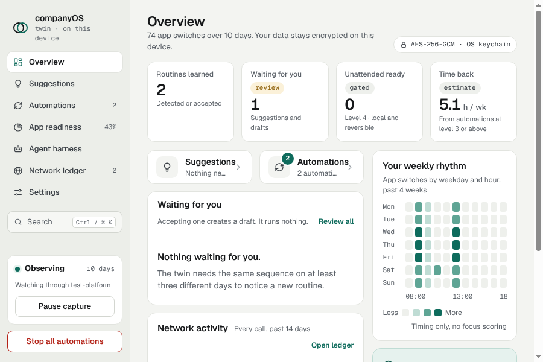

# companyOS Twin

companyOS Twin is a private desktop app for macOS, Windows and Linux (X11). It notices the work you repeat, such as a
spreadsheet, then a document, then an editor, and offers to run that sequence for you. A new automation starts as a
draft. You run it with your approval, and it runs on its own only after it has earned that. Your activity is stored
encrypted on your device. This is an early preview.



Documentation lives in [`docs-site`](docs-site), a Mintlify site that builds and validates locally. Publishing it needs
the owner's Mintlify account.

## What makes it different

- **It records little.** The app name in front, the window type and, if you turn browser capture on, the host and path
  shape of the active tab. Never window titles, page text, typed text, the clipboard, screenshots or keystrokes.
- **Automations earn autonomy.** A routine starts as a draft, and it runs on its own only after eight conditions hold
  for it, only for steps that are local and reversible, and only while the unattended switch is on.
- **The store is encrypted.** One SQLCipher database, opened with a key that the OS keychain seals. Without a keychain
  that can protect the key, the app does not start.
- **Models are open and checked.** Only open-weight models from a fixed catalogue, each checked against its SHA-256
  digest, and every download is written to a network ledger you can read.

## Works today

- **Capture.** Reads the app in front on macOS, Windows and Linux X11, with pause, idle detection, an exclusion list,
  and a pause while the screen is locked. Browser capture is off by default. It works on macOS and Linux only, for
  Chrome and Edge, and it never reports incognito windows.
- **Store.** Encrypted at rest. Raw events, handoffs and task decisions are kept for 90 days. Export writes a plain file
  after a warning. Delete everything removes the database, the data key and the installed models.
- **Today's tasks.** Each day's work is grouped into tasks by fixed rules: app names and the breaks between them. You
  confirm, rename, merge or split each task in the review. Only ids and your action are kept, plus any name you typed.
- **Routines and automations.** Repeated sequences on at least three different days are suggested. An accepted routine
  becomes a draft that can be dry-run. At level 3 you start each run, from the tray offer or with Run now. At level 4,
  with the unattended switch on, a routine of local, reversible steps can run when its app comes to the front. A
  promotion gate and demotion after a failed or undone run keep that honest.
- **App readiness.** For each app, the share of its switches in the last seven days that could run on their own,
  worked out by fixed rules.
- **OpenMausBot handoffs.** Sent after a native confirmation. Each one, with its replies and job tree, opens from its automation.
- **Window.** The main window is a fixed 900 by 600. It cannot be resized, maximised or made full screen, and zoom is off, so the layout is designed for that one size. The sidebar stays in place, and the page column scrolls inside the window.

## Not done yet

- **Model use** stops at naming. Routine detection, labels, policy and safety checks are rule-based. The embedding
  model is downloaded but never loaded. Naming with a real chat model has not been checked, because the tests use a fake
  worker.
- **Steps** are limited. Focusing an app and checking focus work wherever app capture works. Opening a link or a file
  works on macOS and Windows only, and a file asks each time. Pressing a shortcut works on macOS, on Windows and on X11
  through xdotool. It brings the app forward and sends nothing unless the app is in front. Wayland blocks it.
  Typing, clicking and sending are not built. Level 5 is not built.
- **Platforms.** Wayland has no app capture, and Linux cannot open links or files. Windows has no browser capture.
  Intel Macs are not supported by the current builds, which are for Apple silicon.
- **Signing.** Release builds are checked for a Developer ID signature and notarisation, but no certificate has been
  used yet. Windows installers are unsigned, so SmartScreen warns about them.
- **Updates.** Auto-update checks run only when `COMPANYOS_UPDATE_URL` is set to an HTTPS feed. No feed exists yet.
- **Company mode** is not built. `packages/core/src/company` holds only the aggregate release arithmetic.
- **Releases** are built by CI and uploaded as artifacts. Creating the GitHub Release from them is not automated yet.

## Install

Installers are built for each platform. Release installers appear on the GitHub Releases page when a release is
published. The [Install](docs-site/install.mdx) page has the details for each platform. In short:

- **macOS:** an Apple silicon `.dmg`. The app asks for Automation permission for System Events, to read the app in front.
- **Windows:** an NSIS `.exe` for 64-bit Windows. It is unsigned for now.
- **Linux:** a `.deb` and an `.rpm`. It needs an X11 session, `xdotool`, `xprop` (the `x11-utils` package on Debian and Ubuntu), and a keyring that Electron can use.

## Build and run from source

You need Node.js 22 or later.

```bash
npm ci                  # install, and download the Electron binary
npm run typecheck
npm test                # core, desktop, browser extension and measurement tests
npm run test:privacy    # planted canaries must not reach any output
npm run build
npm start               # build, then launch the app from source
npm run dist:dir        # an unpacked app for this system, in apps/desktop/release
npm run dist            # the installers for this system
```

The end-to-end script drives the built app through Playwright, covers setup through to the responsive layout, and needs
network access to huggingface.co for the embedding model. Playwright is not a repository dependency:

```bash
npm run build
npm install --no-save playwright
NODE_PATH=$(npm root)/node_modules node apps/desktop/test/e2e.cjs
```

## Repository layout

- `packages/core`: the twin engine. Redaction, store, segmentation, mining, automations, policy, autonomy and naming.
- `apps/desktop`: the Electron app. `src/main` is the main process, `src/renderer` is the interface, and
  `test/e2e.cjs` is the end-to-end script.
- `apps/browser-ext`: the Chrome and Edge extension and its native messaging host.
- `tests/privacy`: the planted-canary suite.
- `scripts/measure`: a CPU and memory sampler for the resource budgets.
- `docs-site`: the Mintlify documentation. `docs`: the plan and the research notes.
- `.github/workflows`: CI on every push, and the release build for version tags.

## Privacy in short

Activity stays on this device. The only calls the app makes are the ones listed in the network ledger: approved
OpenMausBot handoffs, model downloads from Hugging Face hosts, and update checks when an update feed is set. The
[privacy page](docs-site/privacy.mdx) lists them in full.

## Releases

A release is a version tag that matches `apps/desktop/package.json`, for example `v0.1.0`. Pushing it starts
`.github/workflows/release.yml`, which builds on Ubuntu, macOS and Windows. A macOS release needs these repository
secrets, and it fails without them: `CSC_LINK`, `CSC_KEY_PASSWORD`, `APPLE_API_KEY_P8`, `APPLE_API_KEY_ID` and
`APPLE_API_ISSUER`. Windows signing, `WIN_CSC_LINK` and `WIN_CSC_KEY_PASSWORD`, is optional. The
[releasing page](docs-site/releasing.mdx) explains each step.

## More

- [`docs-site`](docs-site): the user documentation.
- [`docs/plan/README.md`](docs/plan/README.md): the product plan and decision log. Its section 16 describes an older
  MVP, so check this README for the current status first.
- [`docs/research/`](docs/research/): research notes on automation and autonomy, OS capture, prior art, privacy and
  law, and understanding and ML.
