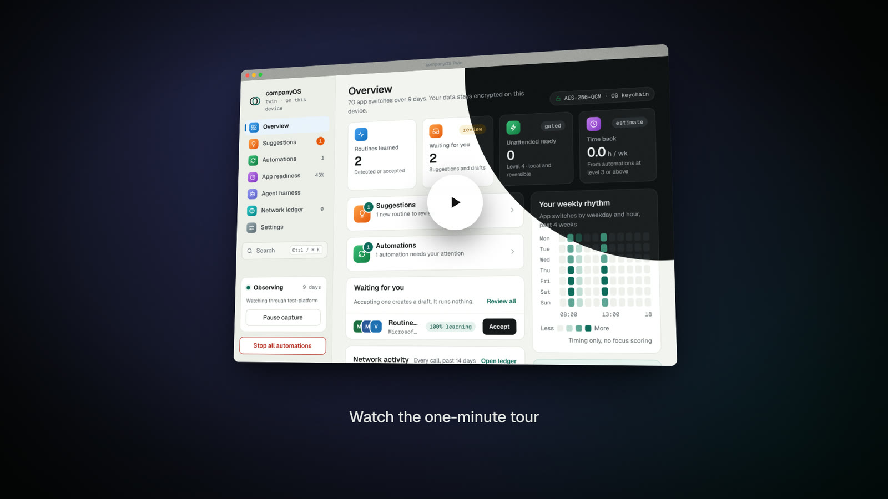

<div align="center">


# companyOS Twin

**A private desktop app that notices the work you repeat and offers to run it for you.**

[Documentation](https://docs.qbrin.com) · [Quickstart](https://docs.qbrin.com/quickstart) · [Install](https://docs.qbrin.com/install) · [Privacy](https://docs.qbrin.com/privacy) · [Releases](https://github.com/katesaikishore/companyOS/releases)

[](https://github.com/katesaikishore/companyOS/actions/workflows/ci.yml)
[](https://docs.qbrin.com)
[](LICENSE)


<a href="docs/companyos-twin-film.mp4"></a>

<sub>A one-minute tour, without sound, recorded with synthetic activity. Select the image to open the video.</sub>

</div>

companyOS Twin runs on macOS, Windows and Linux (X11). It notices the work you repeat, such as a spreadsheet, then a
document, then an editor, and offers to run that sequence for you. A new automation starts as a draft. You run it with
your approval, and it runs on its own only after it has earned that. Your activity is stored encrypted on your device.

> [!NOTE]
> This is an early preview. No release has been published yet, so for now you [build it from source](#build-from-source).

## Why it is different

- **It records little.** The app name in front, the window type and, if you turn browser capture on, the host and path
  shape of the active tab. Never window titles, page text, typed text, the clipboard, screenshots or keystrokes.
- **Automations earn autonomy.** A routine starts as a draft, and it runs on its own only after eight conditions hold
  for it, only for steps that are local and reversible, and only while the unattended switch is on.
- **The store is encrypted.** One SQLCipher database, opened with a key that the OS keychain seals. Without a keychain
  that can protect the key, the app does not start.
- **Models are open and checked.** Only open-weight models from a fixed catalogue, each checked against its SHA-256
  digest, and every download is written to a network ledger you can read.

## How it works

| Step | What happens |
| --- | --- |
| **1. Notice** | The twin records the app in front, its window type and whether you are idle. Browser capture is off by default. |
| **2. Suggest** | A sequence of apps that repeats on at least three different days is offered as a routine. |
| **3. Draft** | An accepted routine becomes a draft automation at level 2. You can dry-run it, and nothing runs for real. |
| **4. Run with you** | At level 3 you start each run, from the tray offer or with **Run now**. Steps that send or write ask again. |
| **5. Earn autonomy** | At level 4, with the unattended switch on, a routine of local, reversible steps can run when its app comes to the front. It gets there only through an eight-condition promotion gate, and a failed or undone run drops it back to level 3. |

[How it works](https://docs.qbrin.com/how-it-works) and [Automations and autonomy](https://docs.qbrin.com/automations)
have the details.

## Platforms

| | macOS | Windows | Linux |
| --- | --- | --- | --- |
| **Installer** | `.dmg`, Apple silicon only | NSIS `.exe`, 64-bit, unsigned | `.deb` and `.rpm` |
| **App capture** | ✓ | ✓ | ✓ on X11, not on Wayland |
| **Browser capture** (Chrome, Edge) | ✓ | — | ✓ |
| **Focus an app** | ✓ | ✓ | ✓ |
| **Open a link or a file** | ✓ | ✓ | ✓ where `gio` is installed |
| **Press a shortcut** | ✓ | ✓ | ✓ through `xdotool` |

- **macOS** asks for Automation permission for System Events, to read the app in front.
- **Linux** needs an X11 session, `xdotool`, `xprop` (the `x11-utils` package on Debian and Ubuntu), and a keyring that
  Electron can use.
- The macOS and Windows step adapters ran on GitHub-hosted machines. Permission prompts and a non-elevated Windows user
  are not verified. The Linux link and file adapter has run only with stand-in apps.

## Status

Capture, the encrypted store, daily tasks, routine suggestions and automations up to level 4 work today. Models only
name routines. Typing, clicking and sending are not built, and no release has been published.

<details>
<summary><b>What works today</b></summary>

- **Capture.** Reads the app in front on macOS, Windows and Linux X11, with pause, idle detection, an exclusion list,
  and a pause while the screen is locked. Browser capture is off by default. It works on macOS and Linux only, for
  Chrome and Edge. The extension skips incognito windows, so no page address is recorded for them. The browser's name
  is still recorded as the app in front.
- **Store.** Encrypted at rest. Raw events and task decisions are kept for 90 days, and handoff records from earlier
  versions too. Export writes a plain file after a warning, with a placeholder for any name you typed for a task or an
  automation. Delete everything removes the database, the data key and the installed models.
- **Today's tasks.** Each day's work is grouped into tasks by fixed rules: app names and the breaks between them. You
  confirm, rename, merge or split each task in the review. Only ids and your action are kept, plus any name you typed.
- **Routines.** Repeated sequences on at least three different days are suggested. With browser capture on, a web site
  is its own step. An unknown app is mined once it recurs on three days, unless its name looks like a web address.
  Shells, script hosts, terminals and system processes, such as Finder or Explorer, are never mined. Each suggestion
  says when the routine usually happens, such as "Usually weekday mornings, around 9 to 11 am".
- **Automations.** An accepted routine becomes a draft that can be dry-run. At level 3 you start each run, from the tray
  offer or with Run now. At level 4, with the unattended switch on, a routine of local, reversible steps can run when its
  app comes to the front. A promotion gate and demotion after a failed or undone run keep that honest. You can rename an
  automation on its page.
- **Declines.** "Not a routine" hides a suggestion, and near copies of it that differ by one step, for routines of three or
  more steps. A "Not now" on an offer holds that routine back for four hours. Each one in a row doubles the wait, up to
  seven days. Accepting the routine or completing a run starts the count again.
- **What the twin knows.** A page that lists the routines the twin has noticed, what you said no to, and your habits over
  the last 28 days: usual hours, typical session, the usual app for each kind of work, and how long you stay in one app.
  Habits need five days of activity. From the page you can forget a suggestion, reset a decline or open an automation.
- **App readiness.** For each app, the share of its switches in the last seven days that could run on their own,
  worked out by fixed rules.
- **Window.** The main window is a fixed 900 by 600. It cannot be resized, maximised or made full screen, and zoom is
  off, so the layout is designed for that one size. The sidebar stays in place, and the page column scrolls inside the
  window.

</details>

<details>
<summary><b>What is not done yet</b></summary>

- **Model use.** A local chat model names routines. The recommended model is now Qwen3 1.7B, which gave a usable name for
  88% of test routines, against 52% for Qwen3 0.6B and 93% for Qwen3 4B. The 4B model is not recommended, because most of its
  names were generic (see `docs/research/model-comparison.md`). An optional Laya decision model (about 1.7 GB, checked against
  pinned SHA-256 digests) labels a routine that includes an app the catalogue does not know. It shows the label only at 0.7
  confidence or more. On 57 catalogue names, those labels matched the catalogue 95% of the time, for 35% of the names. The
  rules label everything else, and no policy or approval reads a label. Routine detection, policy and safety checks are
  rule-based. The embedding model is in the catalogue, but setup does not offer it, because nothing uses it yet.
- **Steps** are limited. Focusing an app and checking focus work wherever app capture works. Opening a link or a file
  works on macOS, Windows and Linux X11 (where `gio` is installed), and a file asks each time. The Linux adapter has run
  only with stand-in apps. Pressing a shortcut works on macOS and Windows and, on X11, through xdotool. It brings the app
  forward and sends nothing unless the app is in front. Wayland blocks it. The macOS and Windows adapters ran on
  GitHub-hosted macOS 26 and Windows Server 2025 machines, where focus, key presses and file open worked. Permission
  prompts and a non-elevated Windows user are not verified. See
  [`docs/research/adapter-smoke-results.md`](docs/research/adapter-smoke-results.md). An optional agent-desktop "hands"
  executor counts an app's windows before a focus on any platform, and it presses keys on macOS and Windows. On Linux the
  program knows an app by its process name, while companyOS records the window class, so for an app whose two names differ
  the count can miss several windows. Focus and key presses on Linux use the built-in adapters. It is off by default, it
  needs a program path set in Settings, and the program is not bundled.
  Typing, clicking and sending are not built. A design is in
  [`docs/research/input-steps-proposal.md`](docs/research/input-steps-proposal.md). Level 5 is not built. A web site
  step focuses its browser and checks it. It does not open the site.
- **Routine changes.** Routines with a web site step have new ids, because the site is part of the routine's key. An
  automation accepted, or a routine dismissed, before the site was kept is moved to the new id when exactly one detected
  routine had the old id, so it stays accepted or hidden. When two routines had the old id, neither is moved: the
  automation is no longer linked to a routine, and the routine shows as a suggestion again. Default names use window
  classes, so routines that differ only by site can share one.
- **Web addresses.** A site keeps its first path segment when it is lower case and up to 12 letters, so a user name can
  show on What the twin knows. Changing that rule needs a decision.
- **Platforms.** Wayland has no app capture. Windows has no browser capture.
  Intel Macs are not supported by the current builds, which are for Apple silicon.
- **Signing.** Release builds are checked for a Developer ID signature and notarisation, but no certificate has been
  used yet. Windows installers are unsigned, so SmartScreen warns about them.
- **Updates.** Auto-update checks run only when `COMPANYOS_UPDATE_URL` is set to an HTTPS feed. No feed exists yet. After
  the first release it can be `https://github.com/katesaikishore/companyOS/releases/latest/download`.
- **Company mode** is not built. `packages/core/src/company` holds only the aggregate release arithmetic.
- **Releases.** Pushing a version tag builds the installers on macOS, Windows and Linux and creates a draft GitHub
  Release from them. A person reviews the draft and publishes it by hand. No tag has been pushed yet, so no release
  exists. The macOS job fails until the signing and notarisation secrets are added, and then no draft is created.

</details>

## Install

Release installers will appear on the [Releases page](https://github.com/katesaikishore/companyOS/releases) once a
release is published. None has been published yet. The [Install guide](https://docs.qbrin.com/install) has the details
for each platform. Until then, build the app from source.

## Build from source

You need Node.js 22 or later.

```bash
npm ci                  # install, and download the Electron binary
npm run typecheck
npm test                # core, desktop, browser extension and measurement tests
npm run test:privacy    # planted canaries must not reach any output
npm run build
npm start               # build, then launch the app from source
npm run dist:dir        # an unpacked app for this system, in apps/desktop/release
npm run dist            # the installers for this system
```

<details>
<summary><b>End-to-end test</b></summary>

The end-to-end script drives the built app through Playwright, covers setup through to the responsive layout, and needs
network access to huggingface.co for the embedding model. Playwright is not a repository dependency:

```bash
npm run build
npm install --no-save playwright
NODE_PATH=$(npm root)/node_modules node apps/desktop/test/e2e.cjs
```

</details>

See [Development](https://docs.qbrin.com/development) for the other commands and the CI checks.

## Repository layout

| Path | What it holds |
| --- | --- |
| [`packages/core`](packages/core) | The twin engine: redaction, store, segmentation, mining, automations, policy, autonomy and naming. |
| [`apps/desktop`](apps/desktop) | The Electron app. `src/main` is the main process, `src/renderer` is the interface, and `test/e2e.cjs` is the end-to-end script. |
| [`apps/browser-ext`](apps/browser-ext) | The Chrome and Edge extension and its native messaging host. |
| [`tests/privacy`](tests/privacy) | The planted-canary suite. |
| [`scripts/measure`](scripts/measure) | A CPU and memory sampler for the resource budgets. |
| [`docs-site`](docs-site) | The source of the documentation at [docs.qbrin.com](https://docs.qbrin.com). |
| [`docs`](docs) | The product plan and the research notes. |
| [`.github/workflows`](.github/workflows) | CI on every push, the docs check, the adapter smoke runs, and the release build for version tags. |

## Documentation

The user documentation is published at **[docs.qbrin.com](https://docs.qbrin.com)**:
[Quickstart](https://docs.qbrin.com/quickstart) ·
[Install](https://docs.qbrin.com/install) ·
[How it works](https://docs.qbrin.com/how-it-works) ·
[Automations](https://docs.qbrin.com/automations) ·
[App readiness](https://docs.qbrin.com/app-readiness) ·
[Privacy](https://docs.qbrin.com/privacy) ·
[Development](https://docs.qbrin.com/development) ·
[Releasing](https://docs.qbrin.com/releasing)

Its source is [`docs-site`](docs-site), a Mintlify site that builds and validates locally. Changes to `docs-site` are not
published to the site automatically yet.

## Privacy in short

Activity stays on this device. The only calls the app makes are the ones listed in the network ledger: model downloads
from Hugging Face hosts, and update checks when an update feed is set. The [privacy page](https://docs.qbrin.com/privacy)
lists them in full.

## Releases

A release is a version tag that matches `apps/desktop/package.json`, for example `v0.1.0`. Pushing it starts
`.github/workflows/release.yml`, which builds the installers on Ubuntu, macOS and Windows and then creates a draft
GitHub Release from them. Nothing is published automatically: review the draft and publish it by hand.

A macOS release needs these repository secrets, and its job fails without them, so no draft is created: `CSC_LINK`,
`CSC_KEY_PASSWORD`, `APPLE_API_KEY_P8`, `APPLE_API_KEY_ID` and `APPLE_API_ISSUER`. Windows signing, `WIN_CSC_LINK` and
`WIN_CSC_KEY_PASSWORD`, is optional. The [releasing page](https://docs.qbrin.com/releasing) has the checklist for the
first release and the update feed recipe.

## More

- [`docs/plan/README.md`](docs/plan/README.md): the product plan and decision log. Its section 16 describes an older
  MVP, so check this README for the current status first.
- [`docs/research/`](docs/research/): research notes on automation and autonomy, OS capture, prior art, privacy and
  law, and understanding and ML.

## License

companyOS is licensed under the Apache License, Version 2.0. See [LICENSE](LICENSE).
